# Asset Intelligence Copilot — Architecture & Documentation

A chat copilot that answers operators' plain-English questions about an oil field **correctly and with evidence**, remembers
what people tell it, learns from corrections, and says so when people (or the data) disagree.

Challenge: FlytBase Hack Day (Hacktoberfest 2026). Original briefs: `01-problem-statement.md`, `02-dataset-guide.md`,
`03-evaluation-queries.md`, `04-prerequisites.md`. "Today" in the sample data is **2026-10-16**.

**Contents**

1. [The idea in one page](#1-the-idea-in-one-page)
2. [Understanding the data](#2-understanding-the-data)
3. [System architecture](#3-system-architecture)
4. [Data flow](#4-data-flow)
5. [Database architecture](#5-database-architecture)
6. [SQL vs vector search — the decision](#6-sql-vs-vector-search--the-decision)
7. [Ingestion pipeline](#7-ingestion-pipeline)
8. [The query engine (tools)](#8-the-query-engine-tools)
9. [Retrieval (documents and reports)](#9-retrieval-documents-and-reports)
10. [The agent](#10-the-agent)
11. [Memory, feedback and conflicts](#11-memory-feedback-and-conflicts)
12. [How it handles new data](#12-how-it-handles-new-data)
13. [Testing and current status](#13-testing-and-current-status)
14. [Running it](#14-running-it)
15. [Design decisions and known gaps](#15-design-decisions-and-known-gaps)

---

## 1. The idea in one page

Every hard question in this challenge is really one of three things:

| Kind                         | Example                                                     | Where the answer lives                            | How we answer                                        |
| ---------------------------- | ----------------------------------------------------------- | ------------------------------------------------- | ---------------------------------------------------- |
| **Numbers over records**     | "Which 3 wells had the most downtime in the last 4 months?" | weekly inspections, repairs                       | **SQL**, deterministic                               |
| **Rules applied to records** | "Which rules has WELL-0001 broken?"                         | manuals/SOPs (thresholds) + records + report text | **SQL + a rules table** extracted from the documents |
| **Knowledge in prose**       | "When was the spill contained?" "Where is the T350 limit?"  | repair reports, manuals, notes                    | **Hybrid text search** (keyword + embeddings)        |

Three principles drive the whole design:

1. **The LLM never computes.** It picks a tool and phrases the result. Every number, date and ID comes out of a
   deterministic tool. This matters most because the runtime model is a free, small model (Gemma 4) with limited tool-calling
   ability and tight rate limits.
2. **Raw data is never overwritten.** Corrections, notes and user rules are layered _on top_ and applied through SQL views, so
   the original value, the author and the reason are always kept, and the correction flows into every later answer for every user.
3. **Scope is enforced in the data, not in the prompt.** A rule for T350 wells is a row scoped to `well_type = T350`; private
   memory is read with a hard `user_id` filter that the runtime injects (the model cannot choose it).

---

## 2. Understanding the data

### 2.1 What is in the sample dataset

Verified by profiling every file (all 200 wells):

| Source                                       | Volume                                        | Notes                                                            |
| -------------------------------------------- | --------------------------------------------- | ---------------------------------------------------------------- |
| Wells (`metadata.json`)                      | 200 (119 × T200, 81 × T350), 4 areas × 50     | 94 wells also have a separator                                   |
| Inspections (`inspections.jsonl`)            | 39,567                                        | one per well per week, ~2 % missed; 672 flagged spills           |
| Repairs (`maintenance.jsonl`)                | 5,665 (4,156 scheduled, 1,509 corrective)     | 9 still open (end date after today)                              |
| Repair reports (`maintenance-reports/*.md`)  | 1,509                                         | exactly one per corrective repair; 2 have irregular file names   |
| Regulator events (`regulatory-events.jsonl`) | 90                                            | spill reports, notices of violation, responses, site inspections |
| Human notes (`context.jsonl`)                | 141                                           | 56 corrections, 82 operator notes, 3 operator feedback           |
| Fleet files                                  | 15 users, 4 areas, 3 teams, 2 manuals, 3 SOPs | rules live here, not in the records                              |

Referential integrity is clean: no dangling `triggered_by_inspection_id`, `related_inspection_id` or correction target, and
every `report_file` exists on disk.

### 2.2 How the records relate

Everything starts from a **well**. Its type decides which manual (and therefore which thresholds) applies; its weekly
inspections are the main record of what happened; and follow-up records point back to the _inspection_ that triggered them.

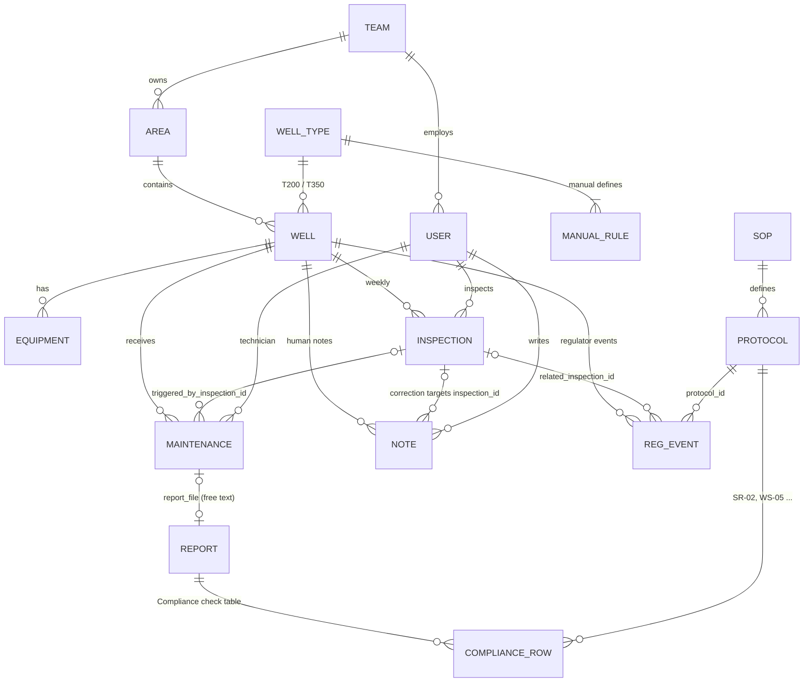

### 2.3 Facts that are _never stored_ — they must be derived

This is the central insight. The questions are mostly about quantities the data does not contain:

| Fact               | Rule                                                                                                                                                                                                                   | Rule comes from   |
| ------------------ | ---------------------------------------------------------------------------------------------------------------------------------------------------------------------------------------------------------------------- | ----------------- |
| **Producing oil?** | `wellhead − ambient ≥ Δ` where Δ = 15 °C (T200) or 20 °C (T350). Absolute temperature is meaningless (an idle wellhead reads > 50 °C on a hot day).                                                                    | manuals §9.3 / §3 |
| **Downtime**       | 7 days × number of inspections that found the well _not producing_. A missed inspection adds 0. **Not** `maintenance.downtime_hours` (that is how long one repair took).                                               | dataset guide     |
| **Real spill**     | `spill_detected` **and** not voided by a correction note ("that was rainwater"). Volume can be overridden by a user correction.                                                                                        | SOP-SR §7         |
| **Spill class**    | < 1 bbl minor · 1–< 5 moderate · 5–< 25 reportable · ≥ 25 major                                                                                                                                                        | SOP-SR §3         |
| **Rule breaches**  | SR-01 written notice ≤ 24 h (2 h for major) · SR-02 contained ≤ 4 h · SR-03 clean-up verified ≤ 60 d · RC-04 notice of violation answered ≤ 30 d · RCA after ≥ 3 corrective repairs on one equipment kind in 12 months | SOPs, manual §10  |
| **Current status** | latest inspection + notes valid today. `recorded_status` is stale **by design**.                                                                                                                                       | dataset guide     |

### 2.4 Traps the design must survive

- `recorded_status` disagrees with the latest inspection.
- The containment time, root cause and the class a report assigned to a spill exist **only inside report text**
  (we found they are cleanly parseable from each report's _Compliance check_ table, row `SR-02`).
- A repair belongs to a period by its **start** date; periods end today and compare by date.
- Two users can disagree about the same inspection; neither note is a formal correction.
- A rule for _one well type_ must not touch wells of another type (WELL-0102 is T200 and must not be hit by a T350 rule).
- One user's conversations must never be visible to another user.

---

## 3. System architecture

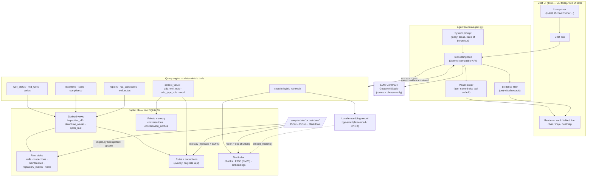

**Layers, bottom to top**

| Layer        | Responsibility                                                                            | Files                                   |
| ------------ | ----------------------------------------------------------------------------------------- | --------------------------------------- |
| Storage      | Raw data, derived views, rules, corrections, text index, private memory — one SQLite file | `schema.sql`, `copilot.db`              |
| Ingest       | Parse a dataset directory into the store; idempotent                                      | `ingest.py`, `rules.py`                 |
| Query engine | Deterministic tools returning `{rows, evidence, visual}`                                  | `tools.py`, `retrieval.py`, `memory.py` |
| Agent        | Tool-calling loop, prompt, visual choice, evidence filtering                              | `agent.py`                              |
| UI           | Renders the chosen visual from the returned rows (CLI now)                                | —                                       |

---

## 4. Data flow

### 4.1 Loading data (ingest)

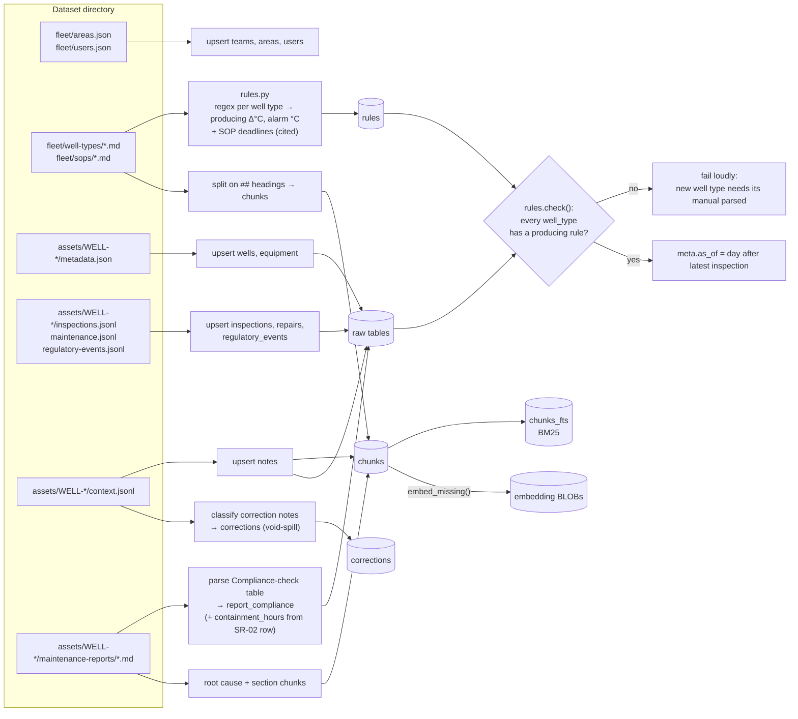

### 4.2 Answering a question (read path)

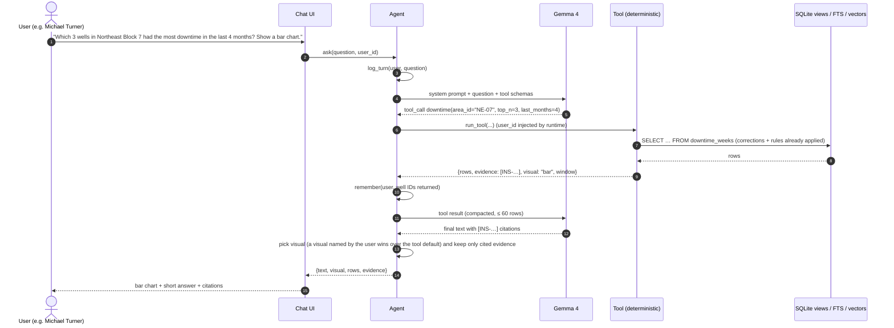

### 4.3 Learning from a user (write path)

```mermaid
sequenceDiagram
    autonumber
    actor M as Michael Turner
    participant Ag as Agent + LLM
    participant Mem as memory.py
    participant DB as SQLite
    actor J as Jessica Reed (later, own chat)

    M->>Ag: "The 15 Oct reading for WELL-0164 is wrong … re-measured at 41.0 °C"
    Ag->>Mem: correct_value(field=wellhead_temp_c, value=41.0, well_id=WELL-0164, reason=…)
    Mem->>DB: resolve inspection INS-0164-0205 (keep original 24.0)
    Mem->>DB: supersede older corrections, then INSERT a corrections row with original, corrected value, author and reason
    Mem->>DB: re-read inspection_eff → producing 0 → 1
    Mem->>Mem: conflict check: inspector note "Pump jack not moving" vs corrected reading
    Mem-->>Ag: {recorded, before/after, conflicts}
    Ag-->>M: Recorded. Original 24.0 kept. Now producing. This disagrees with the inspector note, please confirm
    J->>Ag: "Is WELL-0164 producing oil right now?"
    Ag->>DB: well_status (same views → sees the correction)
    Ag-->>J: "Yes — corrected by Michael Turner; note the inspector's 'Pump jack not moving' disagrees"
```

---

## 5. Database architecture

One SQLite file (`copilot.db`) holds everything. Four groups of objects:

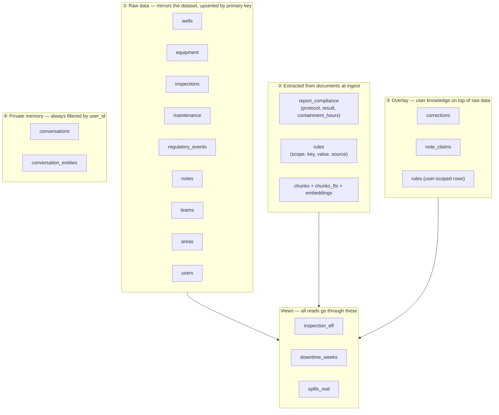

### 5.1 Entity relationships (tables)

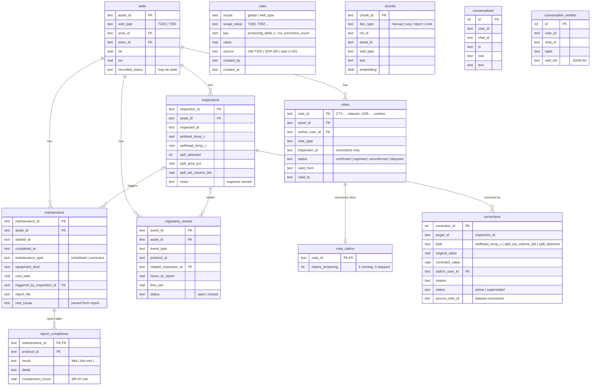

### 5.2 The derived views (the heart of the engine)

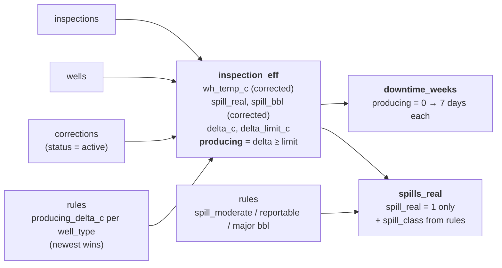

- `inspection_eff` replaces each raw value with `COALESCE(latest active correction, raw)`. Because corrections are rows, not
  overwrites, the original is always available and a newer correction supersedes (not deletes) an older one.
- `downtime_weeks` is literally the weekly inspections where `producing = 0`; summing `days` over any window gives downtime.
- `spills_real` drops detections voided by a correction and classes each spill using the **rules table**, so a volume correction
  that crosses a threshold changes the class (and therefore the deadlines) automatically.

### 5.3 The rules table

Thresholds and deadlines are data, not code. Each row cites its source so the answer can quote it.

| scope     | scope_value | key                                              | value         | source                                                   |
| --------- | ----------- | ------------------------------------------------ | ------------- | -------------------------------------------------------- |
| well_type | T200        | `producing_delta_c`                              | 15            | OM-T200 (parsed from the manual by regex)                |
| well_type | T350        | `producing_delta_c`                              | 20            | OM-T350 (parsed)                                         |
| well_type | T200 / T350 | `temp_alarm_c`                                   | 85 / 95       | manuals (parsed)                                         |
| global    | —           | `sr01_report_hours` / `sr01_major_report_hours`  | 24 / 2        | SOP-SR                                                   |
| global    | —           | `sr02_contain_hours`                             | 4             | SOP-SR                                                   |
| global    | —           | `sr03_verify_days`                               | 60            | SOP-SR                                                   |
| global    | —           | `rc04_response_days`                             | 30            | SOP-RC                                                   |
| global    | —           | `rca_corrective_count`, `rca_window_months`      | 3, 12         | OM-T200 §10                                              |
| global    | —           | `spill_*_bbl`, `spill_shutin_pct`, `rc01/rc03` … | 1/5/25, 5, 14 | SOPs                                                     |
| well_type | T350        | `rca_corrective_count`                           | **2**         | `user:U-201` (Michael Turner's rule — added at run time) |

Lookup order (`tools.rule()`): a **well-type** row beats a **global** row; among several, the **newest** wins. This is how
a user's rule for T350 overrides the manual for T350 only.

---

## 6. SQL vs vector search — the decision

**Use both, in one file.** SQL is the primary engine; vectors are only for prose.

| Question type                                                               | Share of the 18 examples | Engine                 | Why                                    |
| --------------------------------------------------------------------------- | ------------------------ | ---------------------- | -------------------------------------- |
| Aggregations, joins, time windows (downtime, spill counts, costs, heatmaps) | ~14                      | **SQL**                | exact numbers; embeddings cannot count |
| Rule lookup in manuals/SOPs, facts inside reports, recalling notes          | ~4                       | **Hybrid text search** | answer is in prose                     |
| Exact tokens (`SR-02`, `MNT-0082-028`)                                      | —                        | **BM25 (FTS5)**        | embeddings blur identifiers            |

Why not a dedicated vector DB (Chroma, Qdrant, pgvector)? The whole text corpus is **14,699 chunks**
(1,509 reports × ~6 sections, 141 notes, 5 documents). Embeddings take ~22 MB; a NumPy dot product over them is instant.
An extra service would add operational weight with no accuracy gain. _Upgrade path:_ `sqlite-vec` or LanceDB past ~500k chunks.

Why not text-to-SQL as the main path? A small free model writing SQL over a rich schema is the most fragile design available.
Instead the model chooses among **14 small tools** whose SQL we wrote and tested.

---

## 7. Ingestion pipeline

`py -m copilot.ingest [dataset_dir] [db_path]` — about **4 seconds** for the sample; safe to run repeatedly.

| Step          | What happens                                                                                                                                                                                                                                                                                                                    | Why it is safe                                                                  |
| ------------- | ------------------------------------------------------------------------------------------------------------------------------------------------------------------------------------------------------------------------------------------------------------------------------------------------------------------------------- | ------------------------------------------------------------------------------- |
| 1. Fleet      | Upsert teams, areas, users; split every manual/SOP on `## ` headings into chunks                                                                                                                                                                                                                                                | primary-key upsert                                                              |
| 2. Rules      | Parse `producing_delta_c` and `temp_alarm_c` from each `well-types/<type>.md`; add the SOP deadline rows                                                                                                                                                                                                                        | each row cites its document                                                     |
| 3. Wells      | Upsert wells and equipment                                                                                                                                                                                                                                                                                                      |                                                                                 |
| 4. Records    | Upsert inspections, repairs (with cost split), regulator events                                                                                                                                                                                                                                                                 | IDs are globally unique, so a test dataset loads _alongside_ the sample         |
| 5. Reports    | For each `report_file` (always followed from the repair record, never guessed from file names): chunk by section; parse the **Compliance-check table** into `report_compliance`; capture `containment_hours` from the `SR-02` row (`Contained about 7.1 hours after discovery (limit 4 hours)`); store the _Root cause_ section | the table format is fixed across all 1,509 reports (scanned)                    |
| 6. Notes      | Upsert notes; classify each `correction` note → a `corrections` row (`spill_detected: 1 → 0`); warn loudly if a correction is _not_ a void-spill note                                                                                                                                                                           | all 56 sample corrections are void-spill; anything else is flagged, not guessed |
| 7. Guard      | `rules.check()` aborts if any `well_type` in the data lacks a producing rule                                                                                                                                                                                                                                                    | new well type → fail loudly instead of answering wrongly                        |
| 8. Index      | Rebuild FTS5; `meta.as_of` = day after the latest inspection                                                                                                                                                                                                                                                                    | "today" derived from data                                                       |
| 9. Embeddings | `py -m copilot.retrieval` embeds chunks whose text changed (kept if unchanged)                                                                                                                                                                                                                                                  | takes a few minutes once                                                        |

Counts after ingest: wells 200 · inspections 39,567 · maintenance 5,665 · report_compliance 10,380 · regulatory_events 90 ·
notes 141 · corrections 56 · rules 18 · chunks 14,699.

---

## 8. The query engine (tools)

Every tool returns the same shape, which the agent and UI rely on:

```json
{ "rows": [...], "evidence": ["INS-0001-0203", "CTX-0001-003"], "visual": "card|table|line|bar|map|heatmap|text", "window": ["2026-06-16","2026-10-16"] }
```

**Time windows** are expressed with simple arguments the model can fill (`last_days`, `last_weeks`, `last_months`, `since`,
`until`, `this_year`) and resolved by `tools.window()`: inclusive, ending today unless `until` is given, compared by date.
Repairs belong to a window by their **start date**.

### Read tools

| Tool                                        | Answers                                                   | Default visual        | Key logic                                                                                                                                                         |
| ------------------------------------------- | --------------------------------------------------------- | --------------------- | ----------------------------------------------------------------------------------------------------------------------------------------------------------------- |
| `well_status(well_id)`                      | Is this well producing right now? Who inspected? Why not? | card                  | latest `inspection_eff` row; temperature margin vs limit; raw vs corrected temp; active notes, upcoming notes, open repairs, corrections; stale `recorded_status` |
| `find_wells(producing, area_id, well_type)` | Which wells are (not) producing, and why?                 | table                 | per well: open repairs + active notes → `has_recorded_reason`; `corrected_out` lists wells a correction removed from the list                                     |
| `series(well_id, window)`                   | Wellhead vs ambient over time                             | line                  | each point flagged `producing`                                                                                                                                    |
| `downtime(group_by, filters, top_n)`        | Days down by well / area / type / month                   | bar                   | 7 × non-producing inspections; evidence only for returned groups                                                                                                  |
| `spills(filters, group_by)`                 | Real spills, volume, class, location                      | table / map / heatmap | `spills_real` (voided detections removed, corrected volumes); `area_month` gives the heatmap matrix + totals                                                      |
| `compliance(filters)`                       | Breaches and pending duties                               | table                 | see below                                                                                                                                                         |
| `repairs(filters, group_by)`                | Repair lists and cost totals                              | table / bar           | `cost_total` sums; `this_year` flag                                                                                                                               |
| `rca_candidates(equipment_kind, area_id)`   | Wells needing a root-cause analysis                       | table                 | count of corrective repairs per equipment kind in the rule window vs the _effective_ threshold for that well type; cites whose rule set it                        |
| `well_notes(well_id, window)`               | Every human note (any validity)                           | table                 | author name/role, type, status                                                                                                                                    |

### Compliance logic (`tools.compliance`)

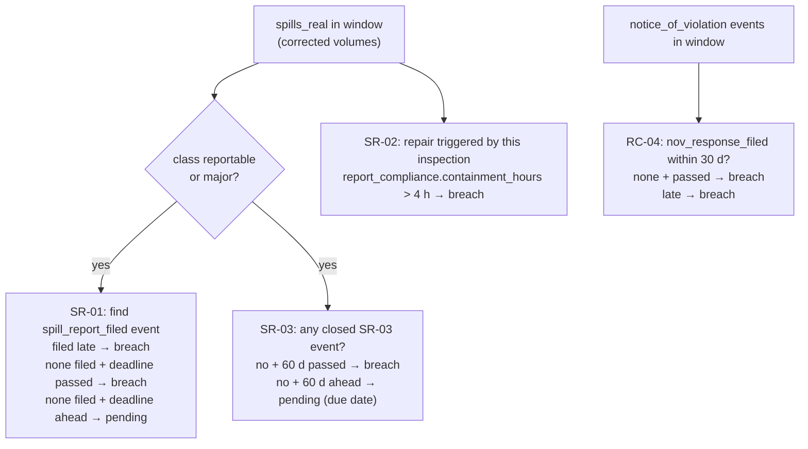

Each row carries `protocol_id`, `status` (`breach` | `pending`), the well, the inspection, a human-readable `detail`, a `due`
date and the evidence IDs (regulator event, repair report, inspection).

### Feedback tools — see [section 11](#11-memory-feedback-and-conflicts)

`correct_value`, `add_well_note`, `add_type_rule`, `recall`.

---

## 9. Retrieval (documents and reports)

`retrieval.search(query, k, doc_type, asset_id, well_type)` → fused ranking of two retrievers:

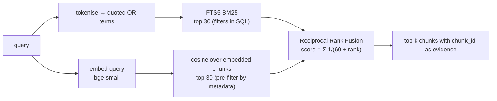

- **Chunks:** manual/SOP sections (`manual:T350:3`), report sections prefixed with `MNT id · well · equipment · issue` so an ID
  query finds them (`report:MNT-0082-028:1`), and every note (`note:CTX-0101-003`).
- **Hard filters** (`doc_type`, `asset_id`, `well_type`) are applied _inside_ the query, never after ranking.
  `well_type` also matches well-agnostic documents (SOPs have no type).
- Verified: "producing temperature threshold for T350" → `manual:T350:3`; "SR-02 containment time limit" → SOP section 3/4 and report
  compliance tables; "who confirmed the stain was crude" (WELL-0101) → `note:CTX-0101-003`.

---

## 10. The agent

`copilot/agent.py` — a minimal tool-calling loop over any **OpenAI-compatible** endpoint (Google AI Studio, OpenRouter, Ollama).
Default: `gemma-4-26b-a4b-it` on Google AI Studio. The API key is read from `LLM_API_KEY` or `GEMINI_API_KEY`
(loaded from the nearest `.env` above the repo; never printed or committed).

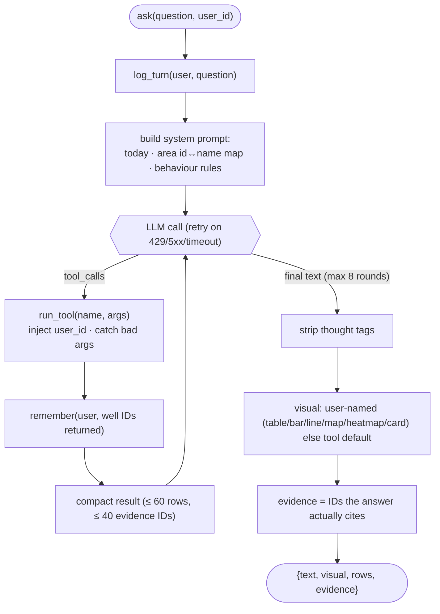

**Why the loop is so thin:** tool schemas are generated from the Python function signatures (`inspect`), so adding a tool is
adding a function to `REGISTRY`. `user_id` is in an `INJECTED` set, so it never appears in a schema — the model cannot ask for
another user's memory.

**What the system prompt enforces** (behaviour, not data): use tools for every fact; map area names to IDs; map phrases like
"last 4 months" to arguments; never invent a cause for a stopped well; state the margin over the limit and flag a stale
`recorded_status`; after any correction report the new state, the compliance consequences, outdated report classifications and every
conflict; cite evidence IDs in brackets; never use another user's private conversation.

**Visual selection** (from `03-evaluation-queries.md`): one well now → card · list → table · change over time → line ·
comparison → bar · locations → map · two dimensions → heatmap. A visual named in the question always wins.

---

## 11. Memory, feedback and conflicts

### 11.1 Three kinds of memory

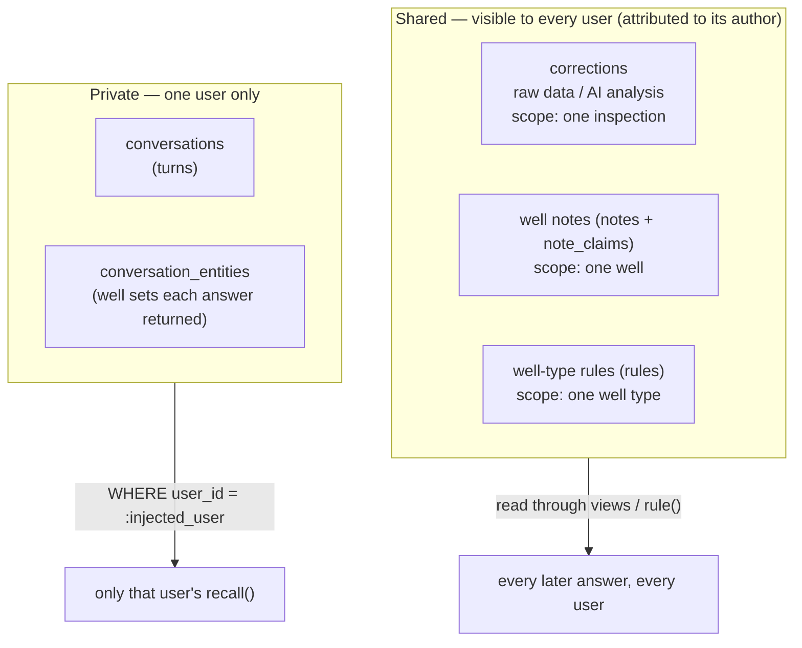

| Memory                                             | Stored in                                | Written by            | Scope             | Visible to                          |
| -------------------------------------------------- | ---------------------------------------- | --------------------- | ----------------- | ----------------------------------- |
| Correct raw data ("the real value is 41.0 °C")     | `corrections`                            | `correct_value`       | one inspection    | everyone                            |
| Correct AI analysis ("the spill was 5.4 bbl")      | `corrections`                            | `correct_value`       | one inspection    | everyone                            |
| Shared fact ("WELL-0007 is shut in from 17 Oct")   | `notes` + `note_claims`                  | `add_well_note`       | one well          | everyone, with author               |
| Rule for a well type ("T350: RCA after 2 repairs") | `rules` (`user:<id>`)                    | `add_type_rule`       | one **well type** | everyone, cited as that user's rule |
| "The three wells we discussed yesterday"           | `conversations`, `conversation_entities` | agent (automatically) | one user          | **only that user**                  |

### 11.2 Corrections keep the original

`correct_value(field, value, reason, well_id | inspection_id, date)`:

1. Resolve the target inspection (a well + date resolves to that day's inspection, default latest).
2. Supersede any earlier active correction of the same field (history kept).
3. Insert `corrections(original_value, corrected_value, author, reason, created_at)`.
4. Re-read the effective state and return **before/after** (`producing`, `spill_class`, `delta_c`).
5. For temperature corrections: compare with the inspector's note (e.g. "Pump jack not moving") and return a **conflict**.
6. For spill corrections: return the **new compliance picture** for that inspection (e.g. SR-01 overdue, SR-03 due date) and what the
   linked repair report had stated (e.g. SR-04 "moderate class"), so outdated analysis is called out.

Allowed fields: `wellhead_temp_c`, `spill_est_volume_bbl`, `spill_detected`.

### 11.3 Conflict handling

`add_well_note(well_id, text, claims_producing, valid_from, valid_to)` — the LLM extracts `claims_producing` (1 running, 0 stopped);
the tool compares it with the facts:

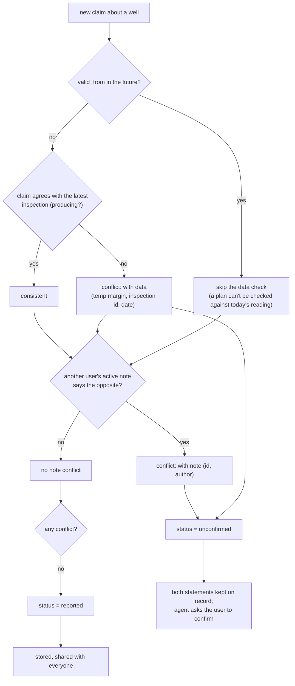

Worked examples (all covered by tests):

| Situation                                                                                           | Result                                                                                       |
| --------------------------------------------------------------------------------------------------- | -------------------------------------------------------------------------------------------- |
| Michael: "WELL-0175 shut in since 14 Oct" (data: 0.4 °C above air → not producing)                  | consistent → `reported`                                                                      |
| Tyler: "WELL-0175 is running fine"                                                                  | conflicts with **data** and with **Michael's note** → `unconfirmed`, both kept               |
| Jake: "WELL-0001 is back online since 14 Oct"                                                       | conflicts with data; active note `CTX-0001-003` (back ~20 Oct) is returned for the answer    |
| Jake: "WELL-0007 shut in from 17 Oct for 10 days"                                                   | future-dated plan → no data conflict → stored; `well_status` lists it under `upcoming_notes` |
| WELL-0101 spill: two notes disagree (produced water vs crude), neither is a correction, repair done | detection stands; both notes (`well_notes`) shown with authors                               |

### 11.4 Scope enforcement

- **Well type:** `rule(key, well_type)` selects `scope='well_type' AND scope_value = <that well's type>` first, else global. A T350 rule
  can never match a T200 well (WELL-0102 stays out).
- **User privacy:** `recall(user_id, days_ago, contains)` always includes `WHERE user_id = ?`, and `user_id` is injected by the
  runtime from the logged-in user. If a user has no such earlier conversation, `recall` returns `empty: true` and the agent says so.
- **"Yesterday":** relative to the data's `as_of` date (2026-10-16), not the machine clock.

---

## 12. How it handles new data

The test dataset arrives in the same format with more wells and history, loaded alongside the sample.

| Risk                                       | Defence                                                                                                                                             |
| ------------------------------------------ | --------------------------------------------------------------------------------------------------------------------------------------------------- |
| Overlapping IDs / extra history            | primary-key upserts; idempotent ingest                                                                                                              |
| A new well type with a different threshold | thresholds parsed from `well-types/<type>.md`; **`rules.check()` fails loudly** if a type has none, instead of silently answering with a wrong rule |
| Different "today"                          | `as_of` = day after the latest inspection (configurable via `meta`)                                                                                 |
| New areas                                  | area ID ↔ name map is read from the DB into the prompt each time                                                                                    |
| A correction note that is not a void-spill | ingest prints a warning and skips it rather than guessing                                                                                           |
| Hard-coded IDs / dates / thresholds        | none in tool code; thresholds come from `rules`, windows from `as_of`                                                                               |
| Report format variation                    | `report_compliance` is parsed from a fixed table format that was scanned across all 1,509 reports                                                   |

_Planned (not built): a "mutated dataset" drill — ingest a copy with a new `T500` type, shuffled IDs and shifted dates._

---

## 13. Testing and current status

### 13.1 Test layers

| Layer                                   | Command                             | What it proves                                                                 |
| --------------------------------------- | ----------------------------------- | ------------------------------------------------------------------------------ |
| Deterministic tools vs expected answers | `py -m copilot.eval.run_examples`   | Q1–Q11 and Q14 (first half) match `03-evaluation-queries.md` exactly           |
| Multi-user memory session               | `py -m copilot.eval.run_memory`     | Q11–Q18 on a throw-away copy of the DB: corrections, scope, privacy, conflicts |
| Real LLM end to end                     | `py -m copilot.eval.run_agent [Q…]` | all 18 questions through Gemma 4, with expected-marker checks                  |

### 13.2 Coverage map

| Q   | Topic                              | Tool path                                | Verified                                                                        |
| --- | ---------------------------------- | ---------------------------------------- | ------------------------------------------------------------------------------- |
| 1   | Status card for WELL-0001          | `well_status`                            | tools ✔ · LLM ✔                                                                 |
| 2   | Not-producing wells in NE-08       | `find_wells`                             | tools ✔ · LLM ✔                                                                 |
| 3   | 13-week line chart                 | `series`                                 | tools ✔ · LLM ✔                                                                 |
| 4   | 6 spills, 15.1 bbl                 | `spills`                                 | tools ✔ · LLM ✔                                                                 |
| 5   | 21 days down in 2025               | `downtime`                               | tools ✔ · LLM ✔                                                                 |
| 6   | Top-3 downtime, bar chart          | `downtime`                               | tools ✔ · LLM ✔                                                                 |
| 7   | Map of 4 spills                    | `spills`                                 | tools ✔ · LLM ✔                                                                 |
| 8   | Area × month heatmap               | `spills(group_by=area_month)`            | tools ✔ · LLM ✔ (visual correct; text terse)                                    |
| 9   | Rules broken by WELL-0001          | `compliance`                             | tools ✔ · LLM ✔                                                                 |
| 10  | Spills not contained in 4 h        | `compliance`                             | tools ✔ · LLM ✔                                                                 |
| 11  | "The wells we discussed yesterday" | `recall` + `repairs`                     | tools ✔ · LLM ✔                                                                 |
| 12  | Correct a raw reading              | `correct_value`, `find_wells`            | tools ✔ · LLM ✔                                                                 |
| 13  | Correct the AI's spill volume      | `correct_value`, `compliance`            | tools ✔ · LLM ✔ (SR-01 overdue, SR-02, SR-03 due 23 Nov, outdated report class) |
| 14  | Well-type rule                     | `rca_candidates`, `add_type_rule`        | tools ✔ · LLM ✔ (WELL-0120 added, WELL-0102 not, cites Michael Turner's rule)   |
| 15  | Correction reaches other users     | `well_status`, `spills`, `compliance`    | tools ✔ · LLM ✔ (author name added to tool output afterwards)                   |
| 16  | Shared knowledge, private memory   | `add_well_note`, `well_status`, `recall` | tools ✔ · LLM ✔ (Jessica correctly told there is no earlier conversation)       |
| 17  | People disagree with the data      | `add_well_note`                          | tools ✔ · LLM ✔                                                                 |
| 18  | People disagree about AI analysis  | `well_notes`, `spills`                   | tools ✔ · LLM ✔                                                                 |

All 12 data checks and all 8 memory-session checks pass. The "LLM" column comes from the **second full Gemma 4 run** of all 18
questions (✔ = expected facts present, right visual, records cited). Remaining soft spots seen in that run: Q8 text gives only one
total (the heatmap rows carry all figures for the UI); Q9 omitted the fine amount and the open flowline root-cause analysis; Q12's
follow-up list did not say why WELL-0164 disappeared; Q15/Q16 did not name the person behind the correction/note. After that run the tools
were changed to return `open_actions` (RCA), a `note` listing wells removed by a correction, and author names on corrections, and the prompt
now requires naming the person — these changes pass the deterministic checks but have **not yet been re-run through Gemma**.
Open items are listed in section 15.

---

## 14. Running it

Requirements: Python 3.10+, `numpy`, `fastembed` (ONNX; no PyTorch). No server, no Docker.

```bash
pip install numpy fastembed

# 1. build the database (about 4 s)
py -m copilot.ingest                 # default: sample-data/ → copilot.db
py -m copilot.ingest path/to/test-data   # load a second dataset alongside

# 2. embed the text chunks (a few minutes, once; only changed chunks are re-embedded)
py -m copilot.retrieval

# 3. checks
py -m copilot.eval.run_examples      # deterministic answers
py -m copilot.eval.run_memory        # memory/feedback/conflict session

# 4. talk to it (needs GEMINI_API_KEY or LLM_API_KEY; optional LLM_BASE_URL, LLM_MODEL)
py -m copilot.agent --user U-201 "Is WELL-0001 producing oil right now?"
py -m copilot.eval.run_agent         # all 18 questions through the LLM
```

Switching model/provider is configuration only:

| Provider                   | `LLM_BASE_URL`                                            | `LLM_MODEL`                             |
| -------------------------- | --------------------------------------------------------- | --------------------------------------- |
| Google AI Studio (default) | `https://generativelanguage.googleapis.com/v1beta/openai` | `gemma-4-26b-a4b-it` / `gemma-4-31b-it` |
| OpenRouter                 | `https://openrouter.ai/api/v1`                            | `google/gemma-4-31b-it:free`            |
| Ollama                     | `http://localhost:11434/v1`                               | `gemma4:e4b`                            |

### File layout

```
copilot/
  schema.sql        tables + views (inspection_eff, downtime_weeks, spills_real)
  ingest.py         dataset directory → SQLite (idempotent), report parsing, chunking
  rules.py          manual regexes + SOP deadlines → rules table; new-well-type guard
  tools.py          read tools: well_status, find_wells, series, downtime, spills, compliance,
                    repairs, rca_candidates, well_notes (+ window(), rule())
  retrieval.py      hybrid search (FTS5 + embeddings, RRF), embed_missing()
  memory.py         correct_value, add_well_note, add_type_rule, log_turn, remember, recall
  agent.py          OpenAI-compatible tool loop, prompt, visual + evidence selection
  eval/
    run_examples.py   deterministic assertions for the example questions
    run_memory.py     scripted multi-user memory session (Q11–Q18)
    run_agent.py      all 18 questions through the real LLM with expected markers
copilot.db          generated; not committed
```

---

## 15. Design decisions and known gaps

### Decisions

| Decision                                            | Reason                                                                                         |
| --------------------------------------------------- | ---------------------------------------------------------------------------------------------- |
| SQL views compute producing / downtime / real spill | the data never stores them; one definition used by every tool                                  |
| Corrections are an overlay                          | original kept, author + reason recorded, applies to all users, supports supersede              |
| Thresholds in a `rules` table with citations        | answers can quote the manual; user rules override per well type; no magic numbers in tool code |
| Small deterministic tools, not text-to-SQL          | reliable on a small free model                                                                 |
| `user_id` injected, not a model argument            | privacy cannot be broken by a prompt                                                           |
| One SQLite file with FTS5 + brute-force vectors     | corpus is ~15k chunks; no extra service                                                        |
| Report facts parsed from a fixed table              | exact, testable, no LLM extraction needed                                                      |
| Conflicts stored, not resolved                      | both statements kept; the user is asked to confirm                                             |

### Known gaps / next steps

- **Compliance:** RC-01 (14-day inspection gap), RC-02 (yearly flowline test) and RC-03 (long downtime report) are not implemented as
  checks. The open root-cause analysis is returned as `open_actions`; the Q9 item "planned shut-in not yet recorded in the maintenance
  system" still relies on the model reading the returned notes.
- **`sql_readonly` escape hatch** over the views was planned but not built.
- **Weaker model behaviours:** Gemma sometimes omits detail (e.g. says "Pump jack not moving" is the reason for WELL-0164 where the
  expected answer is "no recorded reason, inspector noted…"); prompt and tool outputs are tuned but not perfect. Free-tier rate limits and
  read timeouts need retries (implemented).
- **Chat UI:** only a CLI exists; the result object (`text`, `visual`, `rows`, `evidence`) is shaped for a card/table/chart/map/heatmap
  renderer and a user picker, which still need building.
- **Generalisation drill:** the mutated-dataset test (new well type, shuffled IDs, shifted dates) is planned, not run.
- **Correction scope:** value corrections apply to one inspection; well- or type-scoped _data_ corrections are not modelled
  (type scope is supported for rules).
- **Cost write-up:** tokens/requests per question are not logged yet.

---

_All data in this project is synthetic. Manuals and SOPs are fictional and not real operating, legal or regulatory guidance._

---

## Frontend integration and backend compatibility

The frontend is now connected to a real HTTP API (`copilot/server.py`) backed by `copilot.db`; it no longer contains mock data.
The authoritative description — API routes, response shapes, run commands, privacy model, what was changed and known limitations — is in
[`Docs/WEB_UI.md`](../flytbase-ahc-swe-asset-intelligence-dataset/Docs/WEB_UI.md).

Quick start: `py -m copilot.server` (API on :8000) and `npm run dev` in this folder (UI on :5173, `/api` is proxied).
