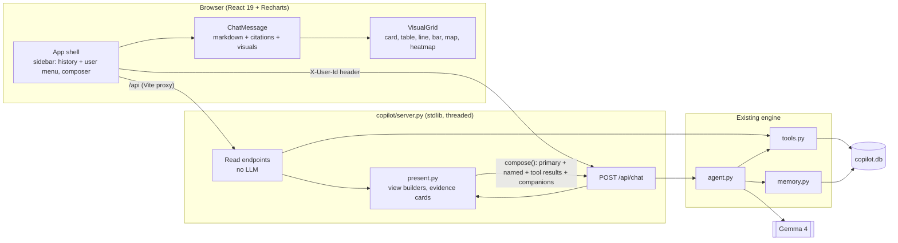

# Web UI and HTTP API

The React app in `FRONTEND/` is a simple chat application (ChatGPT / Claude style): chat history on the left, the conversation in the
middle, one text box at the bottom. It talks to a Python HTTP API (`copilot/server.py`) on top of the same SQLite database, tools and agent
described in `DOCUMENTATION.md`. What makes it more than a text chat is **generated UI**: each answer carries one or more visual components
(status card, table, line chart, bar chart, map, heatmap) drawn from the data the answer was built on. Everything shown comes from
`copilot.db`; there is no mock data. (The earlier dashboard, logs page and side panels were removed; their API routes remain.)

## 1. Run it

```bash
# terminal 1 — API (reads GEMINI_API_KEY from the nearest .env; port 8000)
py -m copilot.server                 # add --reset-demo to wipe notes/corrections/rules/chats created at run time

# terminal 2 — web UI with hot reload (port 5173, proxies /api to :8000)
cd FRONTEND && npm install && npm run dev        # open http://127.0.0.1:5173

# or single process: build once, the API then serves the UI on http://127.0.0.1:8000
cd FRONTEND && npm run build
```

Prerequisites: `copilot.db` built (`py -m copilot.ingest`, then `py -m copilot.retrieval` for the text index), Node ≥ 20.19.
Without a model key the data panels still work and the chat reports that the model is unavailable.

## 2. Architecture



The user is chosen in the UI and sent as the `X-User-Id` header. The server validates it against `users` and injects it into
the agent; the model never chooses it. (This is the "simple user picker" the challenge allows — there is no password login.)

## 3. API

All responses are JSON. Errors are `{ "error": "..." }` with 400 (bad input), 401 (unknown user), 404, 502 (model unavailable or
rate-limited) or 500.

| Route | Purpose | Backed by |
|---|---|---|
| `GET /api/meta` | data date, model, row counts, whether a model key exists | `meta`, counts |
| `GET /api/users`, `/api/areas` | pickers | `users`, `areas` |
| `GET /api/overview?area=` | the four KPI cards | views + `compliance` |
| `GET /api/wells?area=&producing=` | wells with their reasons for stopping | `find_wells` |
| `GET /api/wells/{id}` | well status card | `well_status` |
| `GET /api/wells/{id}/series?weeks=` | wellhead vs air line | `series` |
| `GET /api/downtime?area=&months=&top=` | downtime bar | `downtime` |
| `GET /api/spills?area=&days=` · `/api/spills/heatmap?year=` | map pins · area × month matrix | `spills` |
| `GET /api/compliance?area=&months=` | breaches and pending duties | `compliance` |
| `GET /api/rules` | thresholds with their sources and user overrides | `rules` |
| `GET /api/logs?area=&limit=` | audit stream: regulator events, notes, corrections | `present.logs` |
| `GET /api/evidence/{id}` | readable card for any cited id (inspection, repair, regulator event, note, manual/SOP chunk, rule) | `present.evidence_card` |
| `GET /api/chats` · `GET /api/chats/{id}` | this user's chats; another user's chat id returns 404 | `memory.chats`, `chat_messages` |
| `POST /api/chat` `{chat_id?, message}` | ask the copilot | `agent.ask` |
| `X-Field-Date` (optional header on chat) | simulate the day a message is sent, so "yesterday" can be demonstrated | memory timestamps |

### Chat response

```json
{
  "chat_id": "9a32a00e", "turn_id": 42, "as_of": "2026-10-16",
  "text": "The top 3 wells are … [INS-0121-0189]",
  "visual": "bar",
  "view": { "type": "bar", "unit": "days", "items": [{ "label": "WELL-0121", "value": 49 }] },
  "visuals": [
    { "id": "v0", "source": "primary",   "tool": "downtime", "type": "bar",   "title": "Downtime", "caption": "Northeast Block 7 · 16 Jun 2026 – 16 Oct 2026", "view": { "...": "..." }, "n_rows": 3 },
    { "id": "v1", "source": "companion", "tool": "downtime", "type": "table", "title": "Downtime · data", "caption": "…", "view": { "...": "..." }, "n_rows": 3 }
  ],
  "rows": [ ... ],
  "evidence": ["INS-0121-0189"],
  "steps": [{ "tool": "downtime", "label": "Counting non-producing inspections (7 days each)...", "rows": 3, "error": null }]
}
```

`visuals` (see section 4) is the list the UI draws; `view` is the first of them, kept for clients that draw a single visual. Each view is built
by `present.py` so the UI never guesses row shapes. It is one of:
`card` (well or generic) · `table` (`columns`, flat `rows`) · `bar` (`items`) · `line` (`points`, `limit`) · `map` (`pins` with lat/lon) ·
`heatmap` (`rows`, `cols`, `cells`, `totals`). If rows do not fit the chosen visual the server falls back to a table; text answers have
`view: null`. `steps` come from the real tool calls and are shown as the "what I did" badges.

## 4. Several visuals per answer

The agent used to keep only its last tool result, so an answer could carry one visual. Now it keeps **every** tool result
(`agent.ask → tool_results`) and `present.compose()` plans the visuals of an answer from three sources, in this order:

1. **The primary visual** — the first visual the user names ("show a table and a map" → table first), else the default for the result
   (status card, line, bar, table…). If its data does not fit, it falls back to a table.
2. **Other visuals the user names** ("…and on a map"), built from the newest tool result that fits. A visual that does not fit is skipped, never faked.
3. **Every other tool result** the model produced (two tool calls → two components).
4. **Companions** (at most two), computed deterministically from the primary result with the existing tools — so even a one-call answer is useful:

| Primary result | Companion(s) |
|---|---|
| `well_status` card | 13-week wellhead-vs-air line, not-producing readings marked |
| `series` line | the well's status card |
| `find_wells` table | map of those wells (lat/lon from `wells`) |
| `spills` | map of the spills; bar of bbl per well when more than one well |
| `downtime` bar | the data as a table (days, weeks not producing) |
| `compliance` table | bar of breaches / pending per protocol |
| `repairs` list / grouped | bar of cost per equipment kind / table per well |
| `rca_candidates` table | bar of corrective repairs per well |

Rules: at most **four** visuals; identical views are de-duplicated; a one-number answer ("how many days…") has **no** component; a heatmap stays alone.
Each visual has a **title** and a **caption** (area name, well, date window) and its own **CSV** button. The visuals come from tool results, not from
the model's wording, so they are still shown if the model's write-up times out. The companion registry is `COMPANIONS` in `copilot/present.py`.

## 5. Chats, memory and privacy in the UI

* Chats are stored per user in `conversations`; the structured answer (visuals, rows, evidence, steps) is stored in `chat_payloads`, so a
  reloaded thread looks exactly as it did. Deleting a chat (`DELETE /api/chats/{id}`) removes its turns, stored visuals and remembered well sets;
  another user's chat id returns 404. Follow-ups in a chat get the earlier turns as context (`memory.chat_history`).
* Switching user clears the screen, reloads that user's threads and ignores late replies for the previous user.
  `GET /api/chats/{id}` filters on the header user, so another user's chat id is a 404.
* Shared knowledge (corrections, notes, type rules) is global: the next answer, for any user, uses it and cites its author.
* The user menu (bottom of the sidebar) switches user and has a **Simulate yesterday** toggle that sets `X-Field-Date`, so "the three wells we
  discussed yesterday" can be tested as two sessions on two days.

## 6. Frontend structure

```
FRONTEND/src/
  App.jsx                       state + layout: users, chat history, messages, send / regenerate / delete; retries until the backend is up
  components/Sidebar.jsx        brand, New chat, history list (delete on hover), user menu (switch user, simulate yesterday)
  components/Welcome.jsx        empty state with four suggestion cards
  components/Composer.jsx       auto-growing input, Enter sends, Shift+Enter newline
  components/ChatMessage.jsx    markdown (react-markdown + GFM), [ID] -> citation badge with a popover fed by /api/evidence,
                                visuals, collapsed "How this was answered" and "Sources", copy / regenerate
  components/Visual.jsx         card, table, line, bar, map (SVG scatter by lat/lon, no tile service), heatmap, and VisualGrid
  components/ErrorBoundary.jsx  one bad message never blanks the app
  services/assetApi.js          fetch wrappers: timeouts, error mapping, X-User-Id / X-Field-Date
  lib/export.js                 per-visual CSV
  chat.css, visuals.css         layout and generated-component styles
```

## 7. What had to change to connect the original frontend

The first frontend was built against an imagined backend. Problems found and what was done:

| Problem | Resolution |
|---|---|
| No HTTP server existed; the agent was a blocking Python call | `copilot/server.py`: threaded stdlib server, read endpoints + `POST /api/chat`, static hosting of `FRONTEND/dist` |
| Chat answer was one hard-coded string; no `fetch` anywhere | real chat via `assetApi.send`, with loading, error and retry states |
| Invented routes/shapes (`/api/wells/:id/status`, `{wellId, status…}`) | UI re-based on the real tool result shape `{rows, evidence, visual, view}` |
| Personas U-101…U-401 and areas NW-12 / SE-04, wells "T350" / "A-17" did not exist | users, areas and wells come from the database |
| Fabricated KPIs (184 wells, 96.4 % HSE), pressure readings (the dataset has none), "1,234 contributions" heatmap, invented Q1–Q18 rules | real KPIs from SQL, real rules from the `rules` table, real alerts from `compliance`, real spill heatmap |
| Answers are markdown but were rendered as plain text | `react-markdown` + GFM tables |
| Citations were static strings | ids are parsed from the text; each badge loads a real record card |
| Visual ignored; static charts in a side panel | each answer renders its own card / table / chart / map / heatmap inline |
| Threads lived only in browser state; switching persona changed nothing | server-side chats per user; switching user reloads a private context |
| `tools.db()` shared one SQLite connection | per-thread connections (a threaded server would have crashed) |
| Dead controls: attach, mic, floating button, static slash commands | removed or wired (quick queries, regenerate, copy, open in studio, CSV/JSON export, slash commands expand to real questions) |

## 8. Tests

| Check | Command |
|---|---|
| HTTP API: every read endpoint equals the independent oracle; chat with a scripted LLM (views, steps, persistence, privacy of chat ids, memory via `X-Field-Date`, correction → dashboard + log, 502 on model failure) | `py -m copilot.eval.run_api` |
| Frontend build and lint | `cd FRONTEND && npm run build && npx oxlint` |
| Existing engine checks | `py -m copilot.eval.run_examples`, `py -m copilot.eval.run_memory` |

## 9. Known limitations

* No authentication: the user picker is the "login" (acceptable for the challenge; do not expose the server publicly).
* The overview / wells / logs / rules / compliance API routes are no longer used by the UI (they remain, tested, for later use).
* Gemma on the free tier can take 10–90 s per answer and may rate-limit; the UI shows a working state and a retry button, and the server
  keeps working if the browser disconnects (the answer is saved to the chat).
* The bundle is a single 800 kB chunk (Recharts + markdown); code-splitting is a later optimisation.
* Unused scaffolding remains in `FRONTEND/src` (`demo.tsx`, `components/ui/button.tsx`, `spinner.tsx`, `lib/utils.ts`) and was left untouched.
